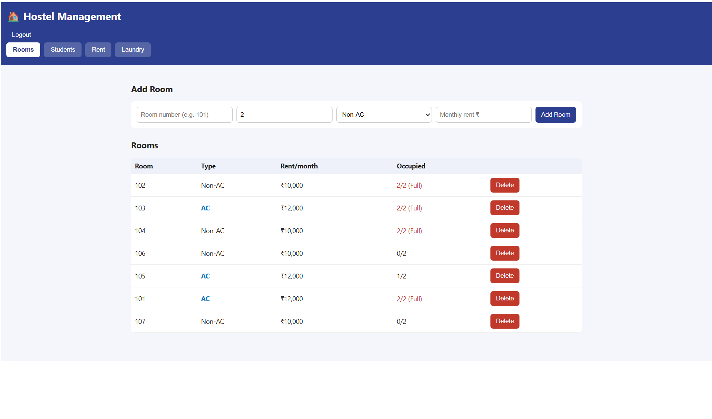

# 🏠 Hostel Management App

A web and Android app to manage hostel rooms, student admissions (capacity 90), rent payments, and laundry, with online data and owner/staff login.

## 🚀 Live Demo
**Web app:** https://arsh17-tech.github.io/hostel-app/

## ✨ Features
- Room allotment with AC and Non-AC rooms
- Student admission with a 90-student hostel limit
- Monthly rent tracking (Paid / Pending)
- Laundry log with status updates
- Real-time cloud database (Firebase Firestore)
- Secure login (Firebase Authentication)
- Works on phones and as an Android app

## 🛠 Tech Stack
HTML · CSS · JavaScript · Firebase (Firestore, Auth) · GitHub Pages · PWA · PWABuilder

## 📱 Install on Android
Download the APK from the Releases section, or open the live link in Chrome and choose **Add to Home screen**.

## 👤 Author
**Arsalan** · [github.com/arsh17-tech](https://github.com/arsh17-tech)
